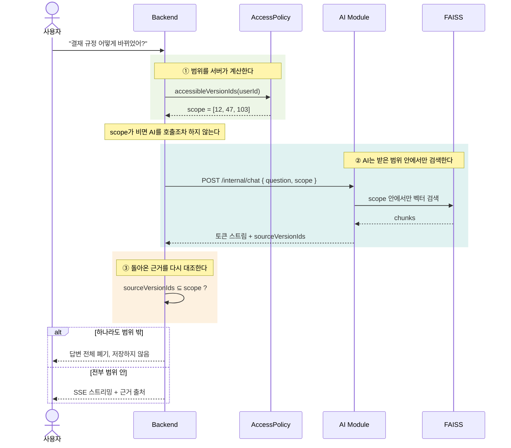
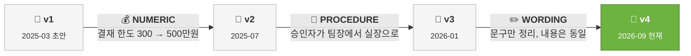
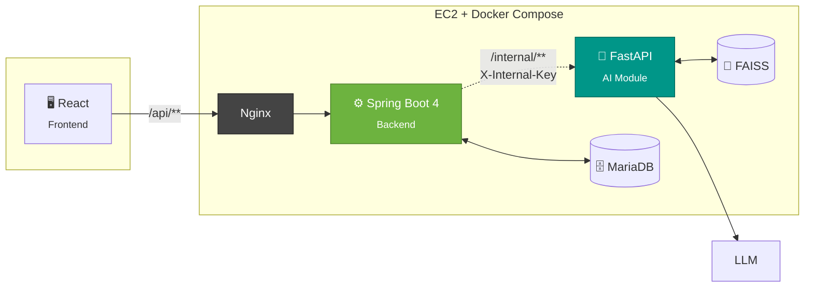

<div align="center">

# 📄 DoQFlow AI

### 사내 문서 Q&A 및 변경 이력 관리

**문서가 버전마다 어떻게 바뀌어 왔는지 한눈에 보고,**
**내가 초대받은 문서만 근거로 답을 받는다.**

<br/>


`SK Shieldus Rookies` `3차 미니프로젝트` `2026.11.05 ~ 11.13`

</div>

<br/>

## 왜 만들었나

사내 문서는 계속 고쳐집니다. 결재 규정이 작년과 다르고, 보안 지침은 분기마다 바뀝니다. 그런데 정작 **무엇이 언제 어떻게 바뀌었는지**는 아무도 모릅니다. 파일명 뒤에 `_최종_진짜최종_v3`이 붙을 뿐입니다.

AI에게 물어보면 되지 않느냐 싶지만, 거기서 더 큰 문제가 생깁니다. **사내 문서에는 아무나 봐서는 안 되는 것이 섞여 있습니다.** 인사 평가 기준, 급여 테이블, 미공개 계약서. 챗봇에 전부 밀어 넣는 순간 권한이 사라집니다.

DoQFlow AI는 이 두 가지를 같이 풉니다.

<br/>

## 🔐 핵심: 권한을 LLM에 맡기지 않는다

이 프로젝트에서 가장 공들인 부분입니다. **"프롬프트에 권한 없는 문서는 빼고 넣는다"로는 부족합니다.** LLM은 결정론적이지 않고, 프롬프트 인젝션에 취약합니다.

서버가 세 겹으로 강제합니다.



| 설계 원칙 | 내용 |
| :-- | :-- |
| **단일 판정 지점** | 모든 권한 판정은 `AccessPolicy` 한 곳을 지난다. 컨트롤러와 서비스 어디서도 직접 판정하지 않는다 |
| **존재 은폐** | 권한 밖 리소스는 `403`이 아니라 `404`다. 응답 코드만으로 문서의 존재를 알 수 없다 |
| **사후 검증** | AI가 돌려준 근거가 허용 범위를 벗어나면 **답변 전체를 폐기**한다. 토큰은 검증을 통과할 때까지 버퍼링한다 |
| **권한 정보 격리** | FAISS 메타데이터에 권한 정보를 넣지 않는다. AI 모듈은 누가 무엇을 볼 수 있는지 영원히 모른다 |

> 초대받지 않은 문서에 어떤 경로로 접근하든 같은 `404`, 같은 문구가 돌아옵니다.
> 문서 단건, 수정, 삭제, 버전 목록, 변천사, 비교, 열람자 목록 8종을 테스트로 고정해 두었습니다.

<br/>

## ✨ 이런 걸 할 수 있습니다

### 📈 변천사 타임라인: 한 문서가 어떻게 흘러왔는지

같은 문서의 여러 버전을 **한 번에 올리면**, 인접한 버전끼리 자동으로 맞대보고 무엇이 달라졌는지 요약합니다. 파일을 하나씩 열어 비교할 필요가 없습니다.



"우리 결재 규정이 작년이랑 뭐가 달라졌지?"에 **문서를 열지 않고** 답이 나옵니다. 변화의 흐름이 한 줄로 보이니, 어느 버전에서 중요한 전환이 있었는지 바로 집어낼 수 있습니다.

변경의 성격을 세 가지로 분류합니다. 숫자가 바뀐 건지, 절차가 바뀐 건지, 표현만 다듬은 건지가 구분되어야 **진짜 봐야 할 변경**을 골라낼 수 있기 때문입니다.

| 분류 | 의미 | 예시 |
| :-- | :-- | :-- |
| `PROCEDURE` | 절차나 주체가 바뀜 | 승인자가 팀장 → 실장 |
| `NUMERIC` | 수치나 기준이 바뀜 | 한도 300 → 500만원 |
| `WORDING` | 표현만 다듬음 | 내용 동일, 문장만 정리 |

요약에 실패한 구간은 `summaryStatus`로 구분해 변경 개수만 보여줍니다. **실패를 성공처럼 꾸미지 않습니다.**

<br/>

### 🔍 두 버전 비교: 정확히 무엇이 바뀌었는지

타임라인에서 눈에 띄는 구간을 찾았다면, 임의의 두 버전을 골라 **좌우로 맞대봅니다.** 인접한 버전이 아니어도 됩니다. v1과 v4를 바로 비교할 수 있습니다.

```diff
  1. 목적
  이 지침은 사내 결재 절차를 정한다.

- 2. 승인 권한
- 500만원 미만은 팀장이 승인한다.
+ 2. 승인 권한
+ 500만원 미만은 실장이 승인한다.
+ 긴급 건은 사후 결재를 허용한다.

  3. 보존
  결재 문서는 5년간 보존한다.
```

바뀐 문단만 블록 단위로 짚어 줍니다. 전체를 눈으로 훑으며 다른 곳을 찾을 필요가 없습니다.

| `type` | 의미 | 위 예시에서 |
| :-- | :-- | :-- |
| `INSERT` | 추가된 블록 | 긴급 건 조항이 새로 생김 |
| `DELETE` | 삭제된 블록 | (없음) |
| `CHANGE` | 수정된 블록 | 승인자가 팀장 → 실장 |

각 블록은 **이전 버전의 몇 번째 줄부터 몇 줄**이고 **다음 버전의 몇 번째 줄부터 몇 줄**인지를 함께 내려줍니다. 화면은 이 좌표로 양쪽을 정렬해 같은 높이에 띄웁니다.

<br/>

### 💬 권한 안에서만 답하는 질의응답

내가 등록했거나 **초대를 수락한** 문서만 근거가 됩니다. 답변에는 어느 문서 몇 페이지에서 나왔는지 출처가 붙습니다. 근거를 못 찾으면 지어내지 않고 못 찾았다고 말합니다.

### 🤝 초대 기반 열람 권한

팀장이 문서를 만들면서 볼 사람을 지정합니다. 초대받은 사람이 **수락해야** 권한이 생기고, 거절하거나 회수하면 다음 요청부터 바로 사라집니다. 수락 전에는 문서의 존재조차 보이지 않습니다.

<br/>

## 🏗 아키텍처



`/internal/**`은 **외부에 공개되지 않습니다.** Nginx가 전달하지 않고, Compose에 포트를 게시하지 않으며, 모든 호출에 `X-Internal-Key`가 필요합니다. Spring Security에서도 `denyAll()`로 한 번 더 막습니다.

<br/>

## 🛠 기술 스택

| 영역 | 사용 기술 |
| :-- | :-- |
| **Backend** | Spring Boot 4.0.9, Spring Security 7, Spring Data JPA, Flyway, JWT(jjwt) |
| **AI / ML** | FastAPI, LangChain, LangGraph, FAISS |
| **Frontend** | React, React Router, Zustand |
| **Database** | MariaDB, FAISS (벡터) |
| **Infra** | Docker Compose, Nginx, AWS EC2, GitHub Actions |
| **Security** | BCrypt, 직급 기반 열람 권한, 감사 로그, OWASP Top 10 자체 점검 |

<br/>

## 📁 프로젝트 구조

```
src/main/java/com/rookies6/DoQFlowAI
├── controller/     8   HTTP 경계. 권한 판정을 직접 하지 않는다
├── service/       20   비즈니스 로직. AccessPolicy를 트랜잭션 안에서 호출
├── repository/     9   JPA. 권한 조건이 들어간 쿼리는 주석으로 근거를 남긴다
├── entity/        18   도메인 모델
├── dto/           37   request, response, ai
├── security/       8   AccessPolicy, JwtProvider, JwtAuthFilter, CurrentUserResolver
├── exception/     17   ErrorCode 단일 표 + 전역 핸들러
└── config/         5   TraceIdFilter, 비동기, 업로드
```

테스트 30종. 단위 테스트와 실제 MariaDB를 쓰는 통합 테스트를 나눠 둡니다.

<br/>

## 🚀 실행

```bash
# 1. 환경 변수
cp .env.example .env     # 필요한 키는 주석과 함께 들어 있습니다

# 2. DB 준비. Flyway가 스키마를 만든다
mysql -u root -p -e "CREATE DATABASE doqflow CHARACTER SET utf8mb4;"

# 3. 기동
./mvnw spring-boot:run           # macOS, Linux
mvnw.cmd spring-boot:run         # Windows
```

```bash
# 단위 테스트. 통합 테스트는 자동으로 건너뜁니다
./mvnw test

# 통합 테스트까지. 실제 MariaDB가 필요합니다
DOQ_IT_DB_URL=jdbc:mariadb://localhost:3306/doqflow_test \
DOQ_IT_DB_USER=... DOQ_IT_DB_PASSWORD=... ./mvnw test
```

통합 테스트는 `DOQ_IT_DB_URL`이 있을 때만 돕니다. 환경 변수가 없으면 조용히 건너뛰므로 DB 없이도 빌드가 통과합니다.

모든 API는 `/api` 아래에 있습니다. 헬스 체크는 `GET /api/actuator/health`입니다.

<br/>

## 👥 팀

<table align="center">
<tr>
<th>이름</th><th>역할</th><th>담당</th>
</tr>
<tr><td><b>홍서연</b></td><td>Team Lead | Backend</td><td>인증, 권한, 보안 전담</td></tr>
<tr><td><b>손인선</b></td><td>Backend</td><td>문서, 버전, 이력, 비교</td></tr>
<tr><td><b>정세진</b></td><td>AI/ML</td><td>대화, AI 모듈 연동</td></tr>
<tr><td><b>김정현</b></td><td>Frontend</td><td rowspan="2">화면, 라우팅, 상태 관리</td></tr>
<tr><td><b>장지웅</b></td><td>Frontend</td></tr>
<tr><td><b>원종현</b></td><td>Frontend | DevOps</td><td>화면, 배포, CI/CD</td></tr>
</table>

<br/>

## 📑 산출물

산출물 9종은 별도로 관리합니다. 이 저장소는 백엔드 코드만 담습니다.

모든 문서는 같은 ID 체계로 서로를 참조합니다.

`A-` 인증, `R-` 직급, `P-` 열람 권한, `D-` 문서, `Q-` 질의응답
`L-` 로그, `C-` 비교, `V-` 이력, `SEC-` 보안 점검

> 각 절 머리에 `관련: V-05 / API-V-05 / TBL-document-version / SEC-04` 형태로 한 줄을 적어
> 계획서 → 설계서 → 코드 → 점검서가 끊기지 않고 추적됩니다.

<br/>

<div align="center">
<sub>SK Shieldus Rookies, Team 03, 2026</sub>
</div>
